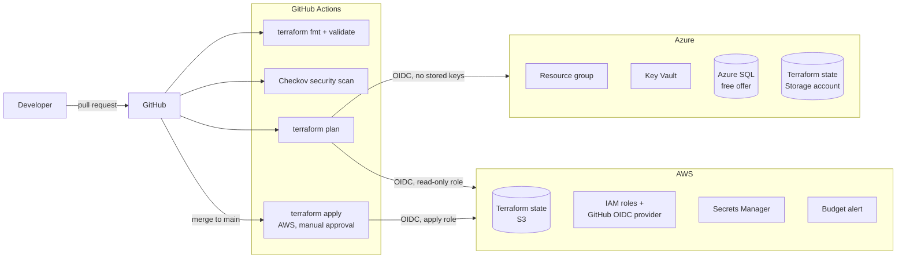

# SE Portfolio

Infrastructure-as-code foundation for a four-project sales-engineering portfolio: identity, APIs, MCP and agentic AI on **Azure and AWS**, with everything deployed through CI/CD and kept at near-zero cost.

This repo is the shared foundation (v0.1). The projects build on it:

1. Azure Entra ID access reviews (Microsoft Graph, SQL, FastAPI)
2. AWS serverless soccer API
3. MCP server and agent
4. Identity-aware AI agent platform (Okta)

## Architecture

## What is in here

| Area | What it does |
|---|---|
| `Azure/` | Resource group, Key Vault, and an Azure SQL database on the free offer (Entra-only sign-in) |
| `AWS/` | S3 state bucket, GitHub OIDC provider, plan and apply IAM roles, Secrets Manager, $5 budget alert |
| `Shared/naming/` | Reusable Terraform module for consistent resource names and tags |
| `Shared/db/` | SQL schema as numbered migrations (SQLite and T-SQL), a migration runner, and seed data |
| `.github/workflows/` | The pipelines below |

## CI/CD

| Workflow | Runs on | What it does |
|---|---|---|
| `terraform-ci` | Pull request | `fmt` and `validate` on every Terraform folder |
| `terraform-security` | Pull request | Checkov scan; fails the PR on unreviewed findings |
| `terraform-plan-azure` | Pull request | `plan` against Azure using OIDC |
| `terraform-plan-aws` | Pull request | `plan` against AWS with a read-only role |
| `terraform-apply-aws` | Merge to `main` | `apply` with a separate role, behind a manual approval gate |

Azure applies are run locally for now.

## Security decisions

- **No cloud keys stored in GitHub.** Both clouds trust GitHub's OIDC tokens, scoped to this repository.
- **Separate plan and apply identities.** Pull requests get a read-only role; only a merge to `main`, after approval, can change infrastructure.
- **Entra-only database sign-in.** The Azure SQL server has no SQL password; access is by Entra identity.
- **Checkov findings are fixed or skipped with a written reason**, inline in the Terraform next to the resource. Skips are deliberate cost and learning-environment tradeoffs, for example a Key Vault without purge protection so it can be rebuilt.
- **Known gap:** the AWS apply role currently has broad permissions. Scoping it down is planned.

## Cost

Everything is designed to stay under a few dollars a month: a $5 AWS budget alert, an Azure SQL database on the free offer that auto-pauses, and no always-on paid resources.

## Running it yourself

Prerequisites: Terraform 1.10 or later, Azure CLI, AWS CLI, Python 3, and free-tier accounts on both clouds.

1. Create the remote state locations once (an Azure Storage account and an S3 bucket) and point each folder's `backend` block at them.
2. Create a `terraform.tfvars` in `AWS/` and `Azure/` with the variables declared there (budget alert email; SQL admin identity and your IP).
3. Run `terraform init` and `terraform plan` in each folder. In CI, add the same values as GitHub secrets and configure the OIDC trust for your own repository.
4. Apply the database schema with the files in `Shared/db/`.